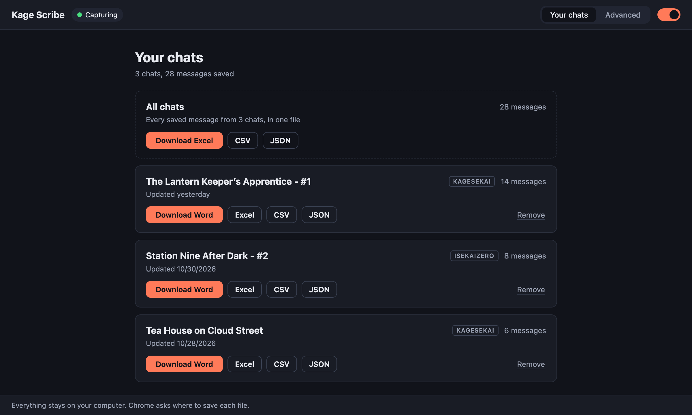
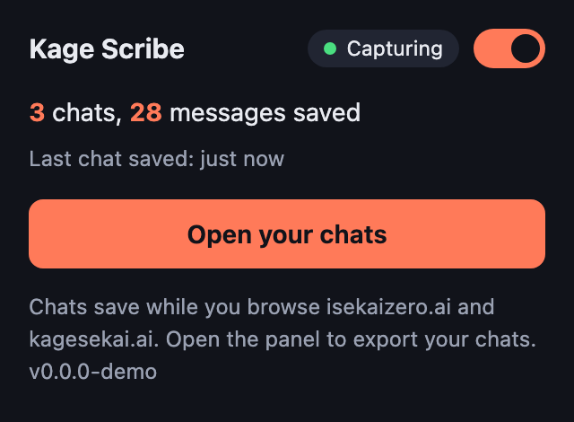
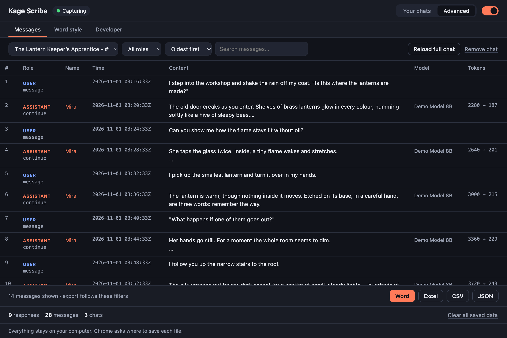
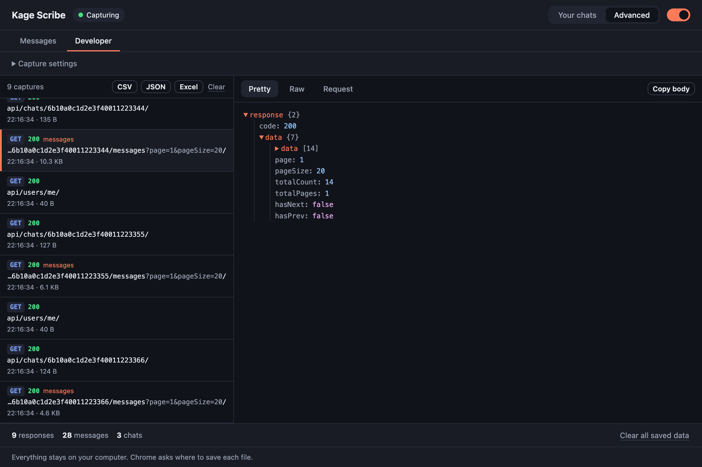

<p align="center">
  
</p>

<h1 align="center">Kage Scribe</h1>

<p align="center">
  A <b>free</b> and <b>private</b> Chrome extension that saves your chats from
  <b>isekaizero.ai</b> and <b>kagesekai.ai</b> while you browse, and exports
  each one as a complete transcript in <b>Word, Excel, CSV or JSON</b>.
  Your chats never leave your computer.
</p>



- **Automatic.** Open a chat on the site and it appears in the list. No copy-paste.
- **Complete.** The site loads history ~10 messages at a time. Before an export,
  Kage Scribe loads the rest, so the file holds the whole chat.
- **Private.** Everything stays on your computer. No analytics, no servers.
  It sends a request to the site only when you click Export or **Reload full
  chat**, to load that chat's full history. Nothing runs in the background.

## Install

Kage Scribe is not on the Chrome Web Store. Install it from a release zip:

1. Download `kage-scribe-<version>.zip` from the repo's **Releases** page and
   unzip it. Keep the folder: Chrome loads the extension from it.
2. Open `chrome://extensions` and turn on **Developer mode** (top right).
3. Click **Load unpacked** and select the unzipped folder.
4. Reload any isekaizero.ai / kagesekai.ai tabs that are already open.

Needs Chrome 111 or newer. Developers can also load the `extension/` folder of
a clone.

### Update

1. Download the new zip and unzip it (the same folder or a new one).
2. On `chrome://extensions`, remove the old Kage Scribe card if a second one
   appears, then **Load unpacked** the new folder (or click the reload icon).

Your saved chats stay: the extension keeps the same ID in every folder.

## Use



1. Browse your chats on the site as usual. Kage Scribe saves them in the
   background; you do not need to open anything.
2. When you want a file, click the toolbar icon, then **Open your chats**.
3. Click **Download Word** on a chat, or **Excel**, **CSV** or **JSON**.
   **All chats** exports everything in one file.

The switch in the toolbar pauses capture. **Remove** takes a chat out of the
list.

<br clear="right">

### Export formats

| Format | What you get |
|---|---|
| **Word** (.docx) | A storybook to read, edit or save as PDF. Each chat starts with a title block (title, site, plot summary, message count). Your messages carry your persona name, scene headers (`Day … Time … Location`) become small italic lines, `*actions*` are italic, and out-of-character (OOC) messages are left out. Several chats start on separate pages. |
| **Excel** (.xlsx) / **CSV** | One row per message: time, role, name, content, model, tokens, cost, IDs and a **Block (20 msgs)** column. Excel adds a filter row. |
| **JSON** | All fields, for scripts. |

**Block (20 msgs)** counts each chat's messages oldest first, 20 to a block
(OOC messages get no block). Filter on one block to copy 20 messages for a
summary. Filters in the panel never change a number. A message deleted on the
site moves the blocks after it, so export again before you summarize the next
block.

The content is the reply the site shows you. If you regenerated a reply, the
other versions are not exported. Excel cuts cells at its 32,767-character
limit; CSV and JSON never cut anything. In CSV, a cell that starts with `=`,
`+`, `-` or `@` gets a leading `'`, so Excel shows it as text instead of
running it as a formula.

## Advanced view

The **Advanced** switch at the top of the panel opens two tabs.

**Messages** shows every saved message in a table, with chat, role, search and
order filters. Exports from here follow the filters. **Reload full chat**
loads a chat's full history on demand.



**Developer** lists every captured API response, with a JSON tree, the raw
body and the request details. **Capture settings** shows which URLs are
recorded (`/api/`) and which one holds chat messages. They are fixed in the
code; a site change ships as an update.



### What a deletion does

A message you delete on the site stays in the **Messages** tab until your next
export or **Reload full chat**. Export checks the chat first: when the saved
count differs from the site's count, it reloads the chat, and the deleted
message does not reach the file.

## Troubleshooting

| Problem | Fix |
|---|---|
| Nothing appears | Reload the site tab after you install. Check that the capture switch is on. |
| "The site logged this session out" | Refresh the site tab, open the chat once, and export again. Nothing partial is saved. |
| A deleted message still shows | Export the chat, or use **Reload full chat** (Advanced → Messages). |
| The popup says **Capture problem** and the toolbar badge shows a red `!` | The site changed its format and Kage Scribe could not read the last chat. Update to the latest release. |
| The popup says "Last chat saved: 3 days ago" after you opened a chat | Nothing is being saved, for example after a site change. Update to the latest release. |

Saved data lives in Chrome's local extension storage. **Clear all saved data**
(Advanced view) or removing the extension deletes it.

## Development

No build step and no dependencies. Plain JavaScript, Manifest V3.

```
extension/        the folder Chrome loads: manifest, service worker, content scripts, panel, popup
tests/            Node test suite
tools/            icon generator and screenshot script
docs/screenshots/ the images in this README
```

```bash
npm test
```

Runs syntax checks, the Node tests and the XLSX/DOCX validators. Needs Node; run `npm install` once first (one dev-only test dependency).

```bash
npm run release
```

Writes `dist/kage-scribe-<version>.zip` from the committed `extension/` folder.
Upload it with `gh release create`.

```bash
npm run icons
```

Redraws `extension/icons/*.png`.

```bash
npm run screenshots
```

Retakes the README images with headless Chrome. They show made-up demo chats.

`AGENTS.md` describes the architecture and the rules for changing the code.
